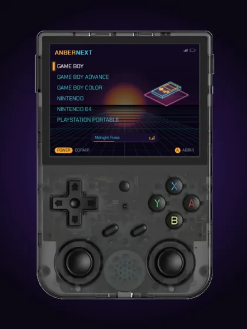
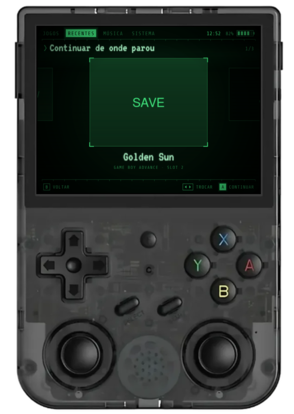
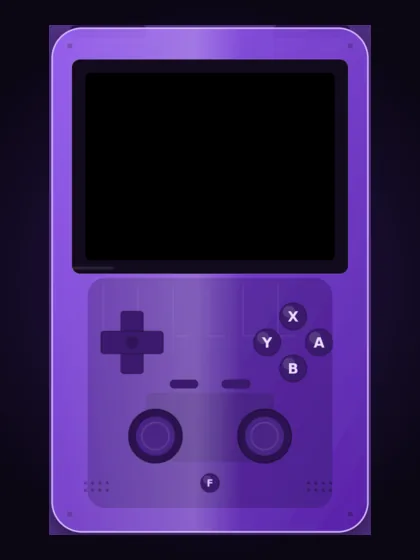

  

  <b>NextUI with four looks of its own, on the Anbernic RG353V and the Anbernic H700 line.</b>

  <a href="#which-file-to-download">Download</a> ·
  <a href="docs/INSTALL.md">Installation guide</a> ·
  <a href="docs/UPDATE.md">Updating from the device</a> ·
  <a href="../../releases">All releases</a>

  

  

---

## Which file to download

| Your handheld | Download |
|---|---|
| **Anbernic RG353V** | the latest **AnberNext v3.x** release: [Releases](../../releases/latest) |
| **RG35XX Plus · RG35XX H · RG35XX SP · RG40XX H · RG40XX V · RG CubeXX · RG28XX** | [**AnberNext H700 v1.0**](../../releases/tag/h700-v1.0): pick the image named after your model |
| **TrimUI Brick** | its own project, [**BrickNext**](https://github.com/retrotiv/BrickNEXT) |

Write the image to a microSD card (balenaEtcher or Raspberry Pi Imager open the `.xz` directly) and
boot from it. Your games card and the console's own system are never written to.

## What this is

AnberNext is my take on **NextUI**, the clean, fast front-end of the TrimUI Brick, brought to
Anbernic handhelds with a look of its own: a new home screen, game library, in-game menu, settings
and boot screen, in four themes you switch in Settings.

It runs entirely from a microSD card you dedicate to it. On the RG353V, hold one button at power-on
and you're back in Android; on the H700 line, take the card out and the stock system is still there.
Nothing on your games card or on the console's internal memory is ever rewritten by AnberNext.

## Four themes

  

**Neon Drive** (synthwave, glowing tubes), **Bloco** (isometric blocks), **Grafite** (clean cards,
a modern console feel) and **Fósforo** (a green, amber or white phosphor terminal). Each theme has
its own home layouts (carousel, list or grid), console drawings and game library, and Settings
previews every option live before you pick it.

## Everything in the theme

<table>
  <tr>
    <td align="center"> <b>Game library</b> covers, the last save slot, play time</td>
    <td align="center"> <b>Music player</b> your own music, also while you play</td>
    <td align="center"> <b>Continue playing</b> back to the exact save, with its picture</td>
  </tr>
  <tr>
    <td align="center"> <b>Quick menu</b> music, settings, tools, power</td>
    <td align="center"> <b>Settings</b> every look option with its preview</td>
    <td align="center"> <b>In-game menu</b> save, load, options, music, in the same theme</td>
  </tr>
</table>

## The boot screen

  

An animated boot screen in the theme you chose, with a progress bar that follows the real boot.

## Runs on

  

- **Anbernic RG353V** (Rockchip RK3566): boots from its own card next to Android.
- **Anbernic H700 line**: RG35XX Plus, RG35XX H, RG35XX SP, RG40XX H, RG40XX V, RG CubeXX and RG28XX,
  each with its own card image. Tested end to end on the RG35XX Plus; the other models use each
  model's own boot loader and kernel, and reports from their owners are very welcome
  ([open an issue](../../issues) with your model and the `relatorio-h700.txt` from the card).

## Features

- **Four themes**, switched in Settings and applied everywhere: home, library, in-game menu,
  Settings and the boot screen. Portuguese (Brazil) or English menus.
- **Built-in music player** in the home screen, with a now-playing card that follows you into games.
- **Boots from its own microSD.** The console's internal storage is never written to.
- **One shared games card.** A card from the TrimUI Brick (or Knulli, muOS...) mounts read-only, so
  saves, box art and collections are the same everywhere; only saves and music are written.
- **Heavier systems included.** N64, Dreamcast, PSP and Nintendo DS (DraStic on the H700 line).
- **HDMI out** on the H700 line, with the sound following the picture to the TV.
- **Wi-Fi and Bluetooth.**
- **Honest battery reading** and, on the RG353V, a **power fix** for the brownouts under load.
- **Hold `F` at power-on for Android** (RG353V).
- **Updates from the device itself**, over Wi-Fi, each model getting only its own files.
  See [Updating from the device](docs/UPDATE.md).

## What you need

- An Anbernic RG353V, or one of the H700 models above.
- A microSD card for AnberNext (the "boot card"). 8 GB is plenty.
- Optionally, your existing games card to share your library.

## A note on safety

Every operation AnberNext performs is scoped to its own card. The in-device updater refuses to run
if it cannot prove it is writing to that card and nowhere else; your games card and the console's
own system are out of bounds by design. The one exception, the RG353V's `F` Android toggle, is
deliberate and documented, and it only ever touches the boot card's own loader area.

## Credits

Built on the work of the NextUI and MinUI authors, the dArkOS project (RG353V) and the Knulli
project (H700 line: boot loaders, kernels and the emulators for the heavier systems). See
[CREDITS.md](CREDITS.md). The handhelds on this page are our own drawings, not the makers' photos.
