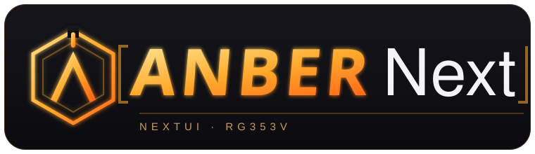

  

  <b>NextUI on the Anbernic RG353V — without giving up Android or your games card.</b>

  <a href="docs/INSTALL.md">Installation guide</a> ·
  <a href="docs/UPDATE.md">Updating from the device</a> ·
  <a href="../../releases">Releases</a>

---

## What this is

AnberNext is my adaptation of **NextUI** — the clean, fast front-end that ships on the
TrimUI Brick — brought over to the **Anbernic RG353V** (Rockchip RK3566).

It runs entirely from a microSD card you dedicate to it. The device's internal storage
and its stock Android are left exactly as they are. Pop the card in and you boot straight
into NextUI; hold one button at power-on and you're back in Android. Nothing on your games
card or on the console's internal memory is ever rewritten by AnberNext.

It started as a handful of compatibility tests — would the Brick's firmware even talk to
this panel, these buttons, this battery gauge? — and grew into a full port with its own
fixes for the things the RG353V does differently.

## Why

I have a TrimUI Brick I love running NextUI, an Anbernic RG353V sitting next to it, and a
single games card I carry between them (and a Miyoo Mini). I wanted the same front-end on
the Anbernic **without** reflashing the console, losing Android, or keeping a second copy
of my library. So: NextUI boots from its own card, Android stays untouched on the internal
memory, and the games card is shared and read-only on the Anbernic so saves and collections
stay in sync across all three handhelds.

## Features

- **Boots from its own microSD.** The console's internal eMMC and its Android install are
  never written to. Remove the card and you have a stock Anbernic again.
- **Hold `F` at power-on for Android.** A safe toggle, the same gesture as Anbernic's own
  dual-boot cards. Let go and next boot is NextUI again.
- **One shared games card.** The same card the TrimUI Brick uses mounts read-only on the
  Anbernic, so saves, box art and collections are the same everywhere.
- **Power / brownout fix.** Under heavy load the RG353V could hard-reset on anything but a
  full battery. AnberNext caps the top CPU step and manages the GPU so those peaks stop
  browning out the cell. ([why](docs/UPDATE.md#o-que-muda-em-cada-versão))
- **Honest battery reading.** The RK817 gauge over-reports; AnberNext cross-checks against
  the cell voltage so the percentage you see is closer to the truth.
- **dArkOS emulators integrated** for the heavier systems the RG353V can handle.
- **Updates from the device itself.** Point it at this repository and it pulls new
  versions over Wi-Fi, rewriting only the NextUI card partition — **never** your games card
  and **never** the internal memory. See [Updating from the device](docs/UPDATE.md).

## Getting started

New install (writes the dedicated boot card once): **[docs/INSTALL.md](docs/INSTALL.md)**.

Already running AnberNext and just want the latest version:
**[docs/UPDATE.md](docs/UPDATE.md)** — no reflashing, straight from the handheld.

## What you need

- An Anbernic RG353V.
- A microSD card for AnberNext (the "boot card"). 8 GB is plenty; the whole thing is ~4 GB.
- Optionally, your existing TrimUI Brick games card to share your library.

## A note on safety

Every operation AnberNext performs is scoped to its own card partition. The in-device
updater refuses to run if it cannot prove it is writing to that partition and nowhere else;
your games card and the console's Android are out of bounds by design. The one exception —
the `F` Android toggle — is deliberate and documented, and it only ever touches the boot
card's own loader area.

## Credits

Built on the work of the NextUI and MinUI authors and the dArkOS project. See
[CREDITS.md](CREDITS.md).
