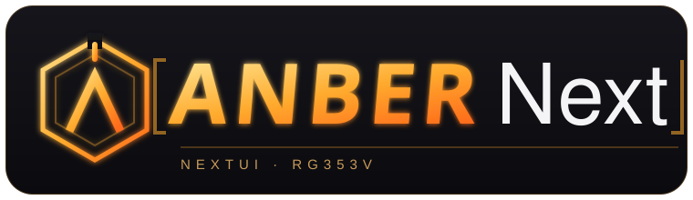
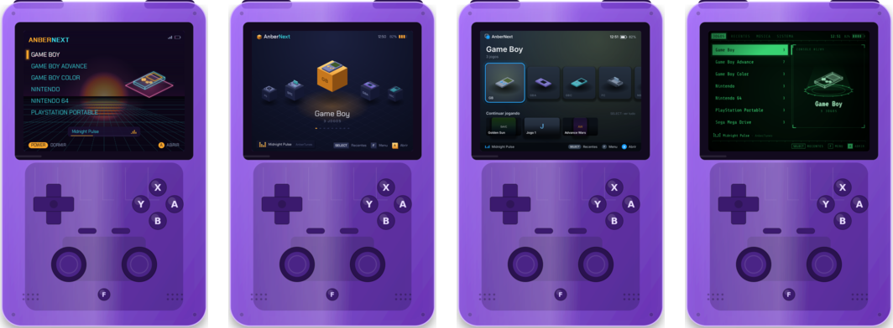
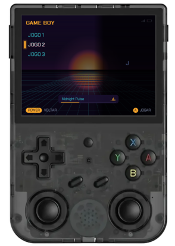
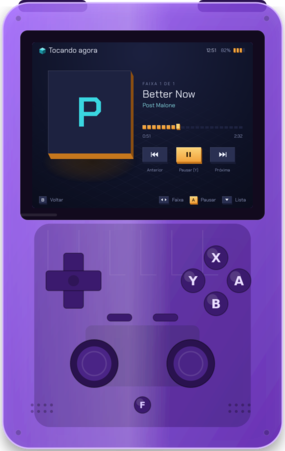
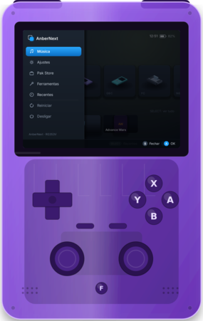
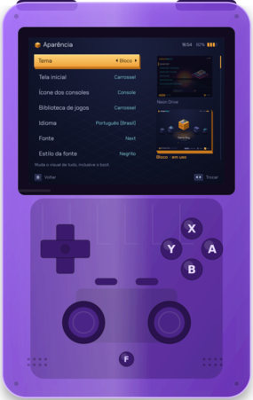
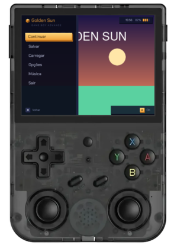
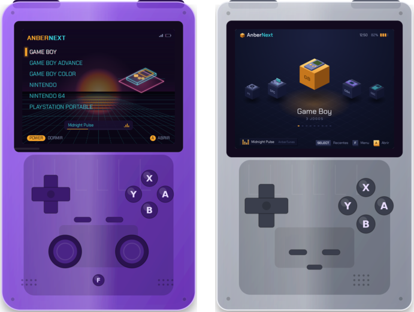

  

  <b>NextUI com quatro visuais próprios, no Anbernic RG353V e na linha Anbernic H700.</b> 
  <i>NextUI with four looks of its own, on the Anbernic RG353V and the Anbernic H700 line.</i>

  <a href="#qual-arquivo-baixar">Download</a> ·
  <a href="docs/INSTALL.md">Instalação / Install</a> ·
  <a href="docs/UPDATE.md">Atualizar / Update</a> ·
  <a href="../../releases">Releases</a> ·
  <a href="#english">English</a>

  

  

---

## Português

### Qual arquivo baixar

| Seu aparelho | Download |
|---|---|
| **Anbernic RG353V** | a release mais recente do **AnberNext v3.x**: [Releases](../../releases/latest) |
| **RG35XX Plus · RG35XX H · RG35XX SP · RG40XX H · RG40XX V · RG CubeXX · RG28XX** | [**AnberNext H700 v1.0**](../../releases/tag/h700-v1.0): escolha a imagem com o nome do seu modelo |
| **TrimUI Brick** | projeto próprio, o [**BrickNext**](https://github.com/retrotiv/BrickNEXT) |

Grave a imagem num cartão micro SD (balenaEtcher ou Raspberry Pi Imager abrem o `.xz` direto) e
ligue o aparelho com ele. O seu cartão de jogos e o sistema do próprio console nunca são alterados.

### O que é

O AnberNext é a minha versão do **NextUI**, a interface limpa e rápida do TrimUI Brick, levada para
os portáteis da Anbernic com um visual próprio: tela inicial, biblioteca de jogos, menu dentro do
jogo, Ajustes e animação de boot novos, em quatro temas que você troca nos Ajustes.

Ele roda inteiro de um cartão micro SD só dele. No RG353V, segurando um botão ao ligar você volta
para o Android; na linha H700, é só tirar o cartão e o sistema de fábrica continua lá.

### Quatro temas

  

**Neon Drive** (synthwave, tubos de neon), **Bloco** (blocos isométricos), **Grafite** (cartões
limpos, cara de console moderno) e **Fósforo** (terminal de fósforo verde, âmbar ou branco). Cada
tema tem seus jeitos de mostrar os consoles (carrossel, lista ou grade), seus desenhos de console e
sua biblioteca de jogos, e os Ajustes mostram a prévia de cada opção antes de você escolher.

### Tudo no tema

<table>
  <tr>
    <td align="center"> <b>Biblioteca</b> capas, último save, tempo de jogo</td>
    <td align="center"> <b>Música</b> a sua música, também durante os jogos</td>
    <td align="center"> <b>Continuar jogando</b> de volta ao save exato, com a imagem dele</td>
  </tr>
  <tr>
    <td align="center"> <b>Menu rápido</b> música, ajustes, ferramentas, desligar</td>
    <td align="center"> <b>Ajustes</b> cada opção de visual com a sua prévia</td>
    <td align="center"> <b>Menu do jogo</b> salvar, carregar, opções, música, no mesmo tema</td>
  </tr>
</table>

**Sobre a música:** o player de música do AnberNext é o **AnberTunes**, um fork do
**[Boombrick](https://github.com/ujjwal313/boombrick)**, de **[ujjwal313](https://github.com/ujjwal313)**.
O app, e todo o trabalho por trás dele, é do autor do Boombrick; o AnberTunes acrescenta o visual
do AnberNext e o cartão "tocando agora" que aparece na tela inicial e dentro dos jogos.

### A animação de boot

  

Uma animação de boot no tema escolhido, com uma barra que acompanha o boot de verdade.

### Onde roda

  

- **Anbernic RG353V** (Rockchip RK3566): liga do próprio cartão, ao lado do Android.
- **Linha Anbernic H700**: RG35XX Plus, RG35XX H, RG35XX SP, RG40XX H, RG40XX V, RG CubeXX e RG28XX,
  cada um com a sua imagem de cartão. Testado de ponta a ponta no RG35XX Plus; os outros modelos
  usam a parte de inicialização e o kernel de cada modelo, e relatos de quem tem esses aparelhos
  são muito bem-vindos ([abra uma issue](../../issues) com o modelo e o `relatorio-h700.txt` do cartão).

### Recursos

- **Quatro temas**, trocados nos Ajustes e aplicados em tudo: tela inicial, biblioteca, menu do
  jogo, Ajustes e boot. Menus em português (Brasil) ou inglês.
- **Música com o AnberTunes**, com o cartão "tocando agora" que acompanha você dentro dos jogos.
- **Liga do próprio micro SD.** A memória interna do console nunca é alterada.
- **Um cartão de jogos para todos.** O cartão do TrimUI Brick (ou do Knulli, muOS...) é montado só
  para leitura, então saves, capas e coleções são os mesmos em todo lugar; só saves e música são gravados.
- **Consoles mais pesados inclusos:** N64, Dreamcast, PSP e Nintendo DS (DraStic na linha H700).
- **Saída HDMI** na linha H700, com o som indo junto para a TV.
- **Wi-Fi e Bluetooth.**
- **Bateria honesta** e, no RG353V, uma **correção de energia** para os desligamentos sob carga.
- **Segure `F` ao ligar para ir ao Android** (RG353V).
- **Atualização pelo próprio aparelho**, pelo Wi-Fi, cada modelo recebendo só os seus arquivos.
  Veja [Atualizar pelo aparelho](docs/UPDATE.md).

### O que você precisa

- Um Anbernic RG353V, ou um dos modelos H700 acima.
- Um cartão micro SD para o AnberNext (o "cartão de boot"). 8 GB sobram.
- Se quiser, o seu cartão de jogos de sempre, para compartilhar a biblioteca.

### Segurança

Tudo o que o AnberNext faz fica restrito ao próprio cartão. O atualizador do aparelho se recusa a
rodar se não conseguir provar que está gravando nesse cartão e em mais nenhum lugar; o cartão de
jogos e o sistema do console ficam de fora por projeto. A única exceção, o atalho `F` do RG353V para
o Android, é proposital e documentada, e só mexe na área de inicialização do próprio cartão de boot.

---

## English

AnberNext is my take on **NextUI**, the clean, fast front-end of the TrimUI Brick, brought to
Anbernic handhelds with a look of its own: a new home screen, game library, in-game menu, settings
and boot screen, in four themes you switch in Settings. It runs entirely from its own microSD card;
your games card and the console's own system are never written to.

**Which file to download**

| Your handheld | Download |
|---|---|
| **Anbernic RG353V** | the latest **AnberNext v3.x** release: [Releases](../../releases/latest) |
| **RG35XX Plus · RG35XX H · RG35XX SP · RG40XX H · RG40XX V · RG CubeXX · RG28XX** | [**AnberNext H700 v1.0**](../../releases/tag/h700-v1.0): pick the image named after your model |
| **TrimUI Brick** | its own project, [**BrickNext**](https://github.com/retrotiv/BrickNEXT) |

Write the image to a microSD card (balenaEtcher or Raspberry Pi Imager open the `.xz` directly) and
boot from it.

**Features**

- **Four themes**: Neon Drive, Bloco, Grafite and Fósforo, applied everywhere (home, library, in-game
  menu, Settings, boot screen), each with its own layouts and live previews in Settings.
  Portuguese (Brazil) or English menus.
- **Music with AnberTunes**, a fork of **[Boombrick](https://github.com/ujjwal313/boombrick)** by
  **[ujjwal313](https://github.com/ujjwal313)**: the app and the work behind it are theirs;
  AnberTunes adds the AnberNext look and the now-playing card on the home screen and in games.
- **Boots from its own microSD**, next to Android on the RG353V.
- **One shared games card**, mounted read-only: saves, box art and collections are the same
  everywhere; only saves and music are written.
- **Heavier systems included**: N64, Dreamcast, PSP and Nintendo DS (DraStic on the H700 line).
- **HDMI out** on the H700 line, with the sound following the picture to the TV. **Wi-Fi and Bluetooth.**
- **Honest battery reading** and, on the RG353V, a **power fix** for brownouts under load.
- **Hold `F` at power-on for Android** (RG353V).
- **Updates from the device itself**, over Wi-Fi. See [Updating from the device](docs/UPDATE.md).

**Runs on** the Anbernic RG353V and the H700 line (RG35XX Plus, RG35XX H, RG35XX SP, RG40XX H,
RG40XX V, RG CubeXX, RG28XX). Tested end to end on the RG35XX Plus; reports from owners of the other
models are very welcome ([open an issue](../../issues) with your model and the `relatorio-h700.txt`
from the card).

**Safety:** every operation is scoped to AnberNext's own card. The in-device updater refuses to run
if it cannot prove it is writing to that card and nowhere else. The one exception, the RG353V's `F`
Android toggle, is deliberate and documented, and only touches the boot card's own loader area.

---

## Créditos / Credits

Construído sobre o trabalho dos autores do NextUI e do MinUI, do projeto dArkOS (RG353V), do
projeto Knulli (linha H700: inicialização, kernels e os emuladores dos consoles mais pesados) e do
**Boombrick**, de ujjwal313 (o app de música por trás do AnberTunes). Veja [CREDITS.md](CREDITS.md).

Built on the work of the NextUI and MinUI authors, the dArkOS project (RG353V), the Knulli project
(H700 line: boot loaders, kernels and the emulators for the heavier systems) and **Boombrick** by
ujjwal313 (the music app behind AnberTunes). See [CREDITS.md](CREDITS.md).

Fotos dos aparelhos / handheld photos: Anbernic. O AnberNext é um projeto da comunidade, sem ligação
com a Anbernic. / AnberNext is a community project, not affiliated with Anbernic.
